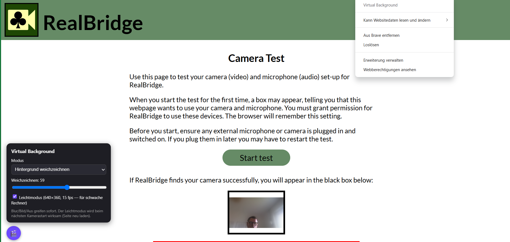
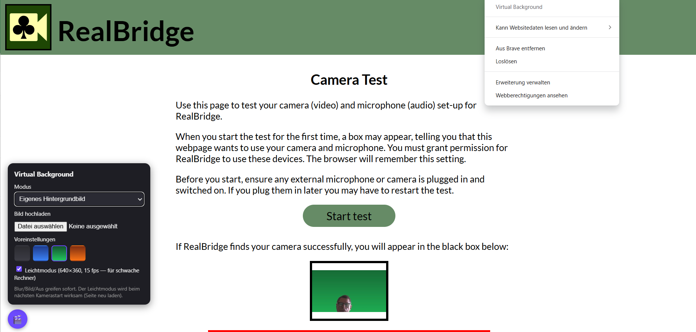

# Virtual Background — Chrome Extension

Browser-Erweiterung (Manifest V3), die Webcam-Streams auf beliebigen Websites
virtuell ersetzt: Hintergrund weichzeichnen, Farbverlauf-Presets oder ein
eigenes Bild. Basierend auf der Bibliothek
[`@vpalmisano/virtual-background`](https://github.com/vpalmisano/virtual-background)
(MediaPipe-Segmentierung + WebGL-Rendering), verpackt als Chrome-Erweiterung.

## Screenshots

**Hintergrund weichzeichnen** (Slider-Wert 59):



**Eigenes Hintergrundbild** (Preset „Grün"):



## Funktionen

- **Weichzeichnen** — Gaußscher Hintergrund-Blur (Slider 1–100, live ohne
  Kamera-Neustart). Die Person bleibt scharf.
- **Eigenes Hintergrundbild** — Vier Farb-Verlauf-Presets (Studio Grau, Blau,
  Grün, Abendrot) oder eigener Upload (JPEG/PNG/WebP, ~max. 4 MB).
- **Aus** — Originalstream unverändert durchlassen.
- **Leichtmodus** — Für schwächere Rechner: kappt die Kamera weich auf
  640×360 @ 15 fps und entlastet CPU/GPU deutlich. Als Checkbox im Panel,
  wirkt beim nächsten Kamerastart (Seite neu laden).
- Alle Einstellungen greifen live und werden in `chrome.storage.local`
  persistent gespeichert. Steuerung über das 🎬-Panel unten links.

## Installation

1. Vier Vendor-Dateien herunterladen (PowerShell):

```powershell
New-Item -ItemType Directory -Force -Path vendor | Out-Null
Invoke-WebRequest -Uri "https://unpkg.com/@vpalmisano/virtual-background/dist/virtual-background.js" -OutFile "vendor/virtual-background.js"
Invoke-WebRequest -Uri "https://cdn.jsdelivr.net/npm/@mediapipe/tasks-vision/wasm/vision_wasm_internal.js" -OutFile "vendor/vision_wasm_internal.js"
Invoke-WebRequest -Uri "https://cdn.jsdelivr.net/npm/@mediapipe/tasks-vision/wasm/vision_wasm_internal.wasm" -OutFile "vendor/vision_wasm_internal.wasm"
Invoke-WebRequest -Uri "https://storage.googleapis.com/mediapipe-models/image_segmenter/selfie_multiclass_256x256/float32/latest/selfie_multiclass_256x256.tflite" -OutFile "vendor/selfie_multiclass_256x256.tflite"
```

2. In Chrome `chrome://extensions` öffnen → Entwicklermodus aktivieren →
   „Entpackte Erweiterung laden" → diesen Ordner wählen.

> **Hinweis:** Die Erweiterung hoakt `getUserMedia` auf allen Seiten
> (`<all_urls>`), damit sie auf jeder Videokonferenz-/Streaming-Website
> funktioniert. Sie verarbeitet Video ausschließlich lokal im Browser und
> sendet nichts. Wer das enger fassen will, kann `matches` in der
> `manifest.json` auf konkrete Domains einschränken.

## Ordnerstruktur

```
virtual-background-extension/
├── manifest.json
├── content.js          # Isolated World: UI-Panel, Einstellungen, Persistenz
├── inject.js           # MAIN World: getUserMedia-Hook, Options-Steuerung
├── screenshot-blur.png
├── screenshot-image.png
├── vendor/             # (siehe Download-Schritt 1, nicht im Repo)
└── THIRD-PARTY-NOTICES.md
```

## Credits / Danksagung

Der Kern dieser Erweiterung ist die Arbeit anderer — erwähnt sei gebührlich:

- **Vittorio Palmisano** — [`@vpalmisano/virtual-background`](https://github.com/vpalmisano/virtual-background)
  (Segmentierungs-/Render-Pipeline, Lizenz: ISC).
- **Google MediaPipe Team** — [`@mediapipe/tasks-vision`](https://www.npmjs.com/package/@mediapipe/tasks-vision)
  (Vision-WASM-Runtime, Apache 2.0) und das Modell
  [`selfie_multiclass_256x256`](https://developers.google.com/edge/mediapipe/solutions/vision/image_segmenter)
  (Apache 2.0 laut Model Card).
- **Lumo** — [lumo.proton.me](https://lumo.proton.me), der datenschutzfreundliche
  KI-Assistent von Proton: Diese Erweiterung wurde gemeinsam mit Lumo
  entwickelt — von der Analyse der Renderer-Pipeline über das Debugging der
  Options-Steuerung bis zu Panel, Presets und dieser Dokumentation.

## Autor

**airzinho** — [github.com/airzinho](https://github.com/airzinho)
(Chrome-Extension-Wrapper, Panel, Presets, Options-Integration, Leichtmodus).
Lizenz: MIT (siehe [LICENSE](LICENSE)). Bugs und Verbesserungsvorschläge
gerne als Issue.

## Lizenzen

Der Wrapper-Code steht unter der MIT-Lizenz (LICENSE). Die gebündelten
Vendor-Dateien stehen unter ihren jeweiligen Upstream-Lizenzen — Details und
Pflichtangaben in [THIRD-PARTY-NOTICES.md](THIRD-PARTY-NOTICES.md).
Die Vendor-Dateien werden bei der Installation automatisch heruntergeladen
und sind Bestandteil der Distribution nur lokal auf dem Anwenderrechner.

## Mitwirken

Issues und Pull Requests sind willkommen.
